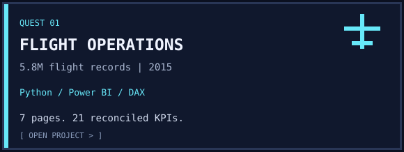
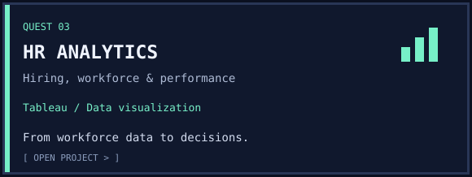

<p align="center">
  
</p>

### `> load player_profile`

I'm a **Data Science student at Georgia State University**, exploring the intersection of **data analytics, business intelligence, and operational decision-making**.

I enjoy cleaning messy datasets, testing the first explanation, and building reports that make the next decision clearer. My projects span flight operations, NLP classification, workforce dashboards, and app-store analysis.

**Current interests:** Data Analytics · Business Intelligence · Operations Analytics internships

<p align="center">
  
</p>

### `> select quest`

<a href="https://github.com/MINNNZZ/flight-delay-operations-analytics"></a>
<a href="https://github.com/MINNNZZ/hackathon-ai-model"></a>
<a href="https://github.com/MINNNZZ/HR-tableau-project"></a>
<a href="https://github.com/MINNNZZ/Editor-choice-analysis"></a>

### `> inspect latest quest`

**[U.S. Flight Operations & Delay Analytics](https://github.com/MINNNZZ/flight-delay-operations-analytics)**

- Cleaned and validated **5.8M+ scheduled flight records** with operationally meaningful missing data and extreme delays preserved.
- Investigated airlines, airports, routes, and time-of-day patterns; challenged findings using matched comparisons and sensitivity checks.
- Built **seven-page Power BI reports in English and Vietnamese**, with **21 DAX KPIs reconciled per edition**.

*Historical 2015 analysis. System/time metrics cover 12 months; named-airport/route comparisons cover 11 resolved months. Association is not causation. AI-assisted workflow documented in the project.*

### `> my playstyle`

```text
01  Start with the business question.
02  Validate the data before trusting the chart.
03  Compare rates, sample sizes, and real-world impact.
04  Challenge the obvious explanation.
05  Turn evidence into a decision worth testing.
```

[Explore all repositories →](https://github.com/MINNNZZ?tab=repositories)


<sub>Banner: AI-generated pixel fan art featuring Gojo Satoru and Sukuna from Jujutsu Kaisen.</sub>
